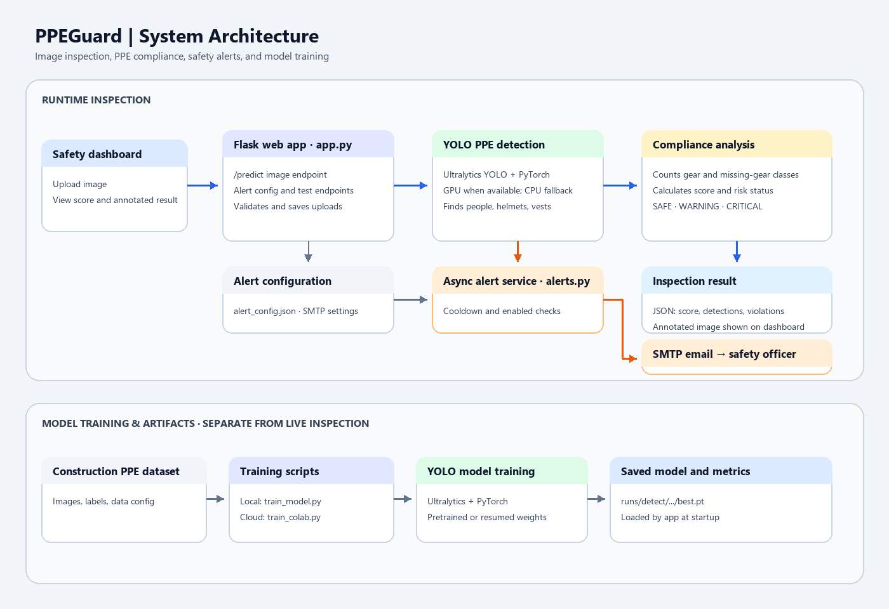

# 🦺 PPEGuard — AI Workplace Safety & PPE Compliance System

[](https://www.python.org/)
[](https://flask.palletsprojects.com/)
[](https://docs.ultralytics.com/)
[](https://pytorch.org/)
[](LICENSE)

An intelligent, computer vision-powered workplace safety monitoring system. **PPEGuard** detects workers, classifies Personal Protective Equipment (helmets, high-visibility vests, etc.), computes a real-time safety compliance score, and automatically dispatches rich HTML email alerts with visual evidence upon detecting safety violations.

---

## 📌 Key Features

- **🎯 Deep Learning Object Detection:** Powered by fine-tuned Ultralytics YOLO (`best.pt`) for detecting personnel and protective gear in complex industrial environments.
- **📊 Dynamic Compliance Scoring:** Evaluates the ratio of personnel to safety gear and checks for explicit non-compliance (`no_helmet`, `no_vest`), yielding a standardized **0–100% compliance score**.
- **🚦 Three-Tier Operational Risk Categorization:**
  - 🟢 **SAFE:** Full compliance across all detected personnel.
  - 🟡 **WARNING:** Minor compliance infractions.
  - 🔴 **CRITICAL:** High-risk violations (e.g., workers without hard hats or high-visibility gear).
- **📧 Automated SMTP Email Alerting:** Asynchronously sends detailed violation summaries along with annotated photographic evidence to designated site safety officers.
- **⏱️ Anti-Spam Cooldown Engine:** Built-in configurable rate-limiting (default: 30 seconds) prevents inbox flooding during ongoing inspections.
- **⚡ Hardware Acceleration:** Auto-detects NVIDIA CUDA GPU acceleration with graceful fallback to CPU.
- **💻 Modern Web Dashboard:** Sleek, dark-mode browser interface featuring drag-and-drop image uploads, live stats, violation breakdowns, and SMTP configuration settings.

---

## 🏗️ System Architecture



The diagram shows the image inspection and alert flow alongside the offline model training pipeline. The current web app accepts uploaded images; a live CCTV ingestion service is not implemented.

---

## 🚀 Getting Started

### 1. Prerequisites
- Python 3.9 or higher
- Git
- (Optional) NVIDIA GPU with CUDA drivers for fast inference

### 2. Installation

1. **Clone the repository:**
   ```bash
   git clone https://github.com/<YOUR_USERNAME>/<YOUR_REPO_NAME>.git
   cd <YOUR_REPO_NAME>
   ```

2. **Create and activate a virtual environment:**
   ```bash
   # Windows (PowerShell)
   python -m venv venv
   .\venv\Scripts\Activate.ps1

   # Linux / macOS
   python3 -m venv venv
   source venv/bin/activate
   ```

3. **Install dependencies:**
   ```bash
   pip install -r requirements.txt
   ```

### 3. Email Alert Configuration

1. Copy the example alert configuration template:
   ```bash
   cp alert_config.example.json alert_config.json
   ```
2. Open `alert_config.json` and fill in your SMTP credentials:
   ```json
   {
       "enabled": true,
       "smtp_server": "smtp.gmail.com",
       "smtp_port": 587,
       "sender_email": "your_email@gmail.com",
       "sender_password": "your_16_digit_app_password",
       "receiver_email": "safety_officer@example.com",
       "cooldown_seconds": 30,
       "attach_image": true
   }
   ```
   > 💡 **Note for Gmail users:** Generate a 16-character **App Password** from your Google Account settings (*Security > 2-Step Verification > App passwords*). Never use your personal account password.

### 4. Running the Application

Start the Flask server:
```bash
python app.py
```
Open your browser and navigate to:
```
http://localhost:5000
```

---

## 📁 Project Structure

```
├── app.py                      # Flask web application & inference pipeline
├── alerts.py                   # SMTP alert dispatcher & cooldown engine
├── alert_config.example.json   # Template for email alert credentials
├── train_model.py              # Local YOLO training pipeline
├── train_colab.py              # Google Colab cloud training script
├── requirements.txt            # Python dependencies
├── templates/
│   └── index.html              # Modern dark-mode web dashboard
├── static/
│   ├── uploads/                # Directory for uploaded input images
│   └── results/                # Annotated inference outputs
├── runs/detect/train-4/
│   ├── weights/best.pt         # Fine-tuned YOLO weights
│   ├── confusion_matrix.png    # Evaluation confusion matrix
│   └── results.png             # Training loss and mAP progression
└── YOLO_PROJECT_DETAILED_REPORT.md  # Comprehensive academic technical report
```

---

## 📈 Training and Performance Metrics

The model was trained on the Construction PPE Dataset with data augmentation (mosaic, flips, color jitter).
- **Architecture:** YOLO Nano backbone (`yolo26n`)
- **Key Classes:** `Person`, `helmet`, `vest`, `no_helmet`, `no_vest`
- **Inference Speed:** ~15–25 ms per frame on CUDA GPU

Evaluation performance curves and confusion matrices are available in [`runs/detect/train-4/`](runs/detect/train-4/).

---

## 🔒 Security Best Practices

- `alert_config.json` is explicitly ignored by [`.gitignore`](.gitignore) to prevent leaking email passwords.
- Always use environment variables or app passwords in production.
- File uploads are validated with secure filename sanitization and extension whitelisting.

---

## 📄 License

This project is licensed under the MIT License — see the [LICENSE](LICENSE) file for details.
